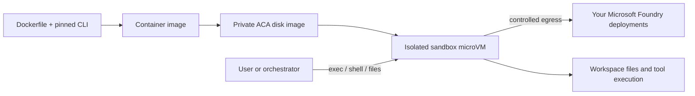

<div align="center">

# Coding agents. Isolated execution. Your Azure models.

**Codex + Claude Code · Microsoft Foundry · Azure Container Apps Sandboxes**

[](https://github.com/roy2392/aca-sandboxes-foundry/actions/workflows/ci.yml)
[](LICENSE)
[](#build-the-images)

Two container images for running coding agents in isolated workspaces while using your own Microsoft Foundry model deployments.

</div>

## What this gives you

| Image | Coding client | Model connection |
|---|---|---|
| `foundry-codex:20261012.2` | Codex CLI `0.146.0` | Azure OpenAI Responses API |
| `foundry-claude:20261012.2` | Claude Code `2.1.287` | Native Microsoft Foundry provider |

Both images run as a non-root user and include Node.js 22, Python 3, Git, curl and ripgrep. Azure account names and deployment names are runtime configuration. Credentials are supplied only when a session starts.

**This repository publishes source and build recipes.** It does not publish prebuilt images or deploy Azure resources automatically. Third-party coding clients retain their own license and service terms.

## How the pieces fit



The agent and its tools execute inside the sandbox. Foundry serves the model. A sandbox group contains the fleet and shared settings; each sandbox has its own kernel and filesystem. Import an image, wait for its disk to become **Ready**, then create a sandbox from that disk ID. Stop and resume between tasks; use snapshots when memory and disk state must be restored together.

Read the [architecture notes](docs/architecture.md) for lifecycle, egress and token renewal.

## Build the images

Prerequisites: Docker Engine/Desktop, Node.js 22+ with npm 10+, Python 3.11+, and Bash. Authenticated runs need Azure CLI and a login to your tenant. Import needs the ACA CLI and an existing sandbox group.

```bash
git clone https://github.com/roy2392/aca-sandboxes-foundry.git
cd aca-sandboxes-foundry
bash scripts/build.sh
python3 -m unittest discover -s tests -v
python3 scripts/verify.py
```

Builds target `linux/amd64`, including on Apple Silicon. npm fetches pinned Linux packages on the host with install scripts disabled. Docker copies them into the image; Claude's official postinstall selects its native binary inside Linux. No credentials are needed to build.

Base-image digests and npm lockfiles are pinned. Debian package versions resolve during a rebuild. Retain the resulting immutable image digest when exact binary reproducibility matters.

## Connect your Foundry deployments

```bash
cp .env.example .env.local
# Edit .env.local with your tenant, subscription, Foundry account,
# deployment names, and sandbox group. Never add an access token.
set -a
source .env.local
set +a
az login --tenant "$FOUNDRY_TENANT_ID"
python3 scripts/verify.py --live
```

`--live` sends one small prompt per image and incurs model usage charges. It checks that both return `FOUNDRY_OK`. The helper verifies the subscription's tenant, obtains an Entra token in memory, and forwards it to the container. It does not change your default Azure subscription.

Use actual **deployment names** from your Foundry account. Configure all three Claude aliases so background tasks do not select an undeployed model.

```bash
python3 scripts/run-local.py codex exec --skip-git-repo-check \
  'Reply hello without using tools.'
python3 scripts/run-local.py claude -p \
  'Reply hello without using tools.' --max-turns 1 --tools ''
```

The local helper mounts no host directories. Its workspace is disposable on exit. To work on a repository, mount only the intended directory at `/workspace` in your own Docker invocation and arrange UID `10001` write permissions. Do not mount your home, Azure cache or Docker socket into an untrusted workspace.

## Import into ACA Sandboxes

After reviewing the targets and deciding to create Azure disk resources:

```bash
python3 scripts/aca-scoped.py sandboxgroup disk list -o json
bash scripts/import-images.sh
```

This uploads the prepared source contexts and builds two private disk images. It does not create a sandbox, resume workloads, assign roles or publish to a registry. Building/importing can incur service charges. The `--source` path requires an ACA CLI version supporting source builds.

The scoped wrapper pins resource routing and Azure token selection to your subscription. It addresses wrong-tenant token behavior observed with ACA CLI `1.0.0-preview.4`, without changing global defaults or permissions.

Wait for **Ready**, record the disk IDs, then follow the [ACA disk-image guide](https://sandboxes.azure.com/docs/sandboxes/disk-images) to create a sandbox. Supply the same non-secret runtime configuration and a fresh token. Validate startup, egress/TLS, model access and an actual coding task before relying on the cloud deployment.

## Authentication and validation

- Entra tokens only. The launcher rejects missing, malformed, expired, wrong-tenant and wrong-audience tokens. Foundry verifies signatures and RBAC.
- Supply `FOUNDRY_AUTH_TOKEN`, or mount `/run/secrets/foundry-token`. Never put a token in Git, a Dockerfile or an image snapshot.
- Tokens are reread at CLI startup; active sessions do not automatically refresh them. Long-running or resumed work needs renewal.
- Tokens in a process are accessible to code with equivalent permissions. Use a reviewed proxy/identity design when credentials must stay outside the workload.
- Local inference does not prove ACA execution or a full tool workflow. See [validation scope and limitations](VALIDATION.md).

## Repository map

| Path | Purpose |
|---|---|
| `images/` | Dockerfiles, launchers, token checks and pinned CLI package locks |
| `scripts/build.sh` | Build both Linux images |
| `scripts/run-local.py`, `scripts/verify.py` | Scoped authentication and verification |
| `scripts/aca-scoped.py`, `scripts/import-images.sh` | Explicit Azure disk import |
| `tests/` | Authentication/configuration regression tests |

## References

[ACA Sandboxes](https://sandboxes.azure.com/docs/sandboxes/) · [Disk images](https://sandboxes.azure.com/docs/sandboxes/disk-images) · [Identity](https://sandboxes.azure.com/docs/sandboxes/identity) · [Costs](https://sandboxes.azure.com/docs/sandboxes/cost) · [Codex configuration](https://developers.openai.com/codex/config-advanced/) · [Claude on Foundry](https://code.claude.com/docs/en/microsoft-foundry)

Independent community sample by Roey Zalta. Not an official Microsoft, OpenAI or Anthropic product. Names and trademarks belong to their respective owners.
